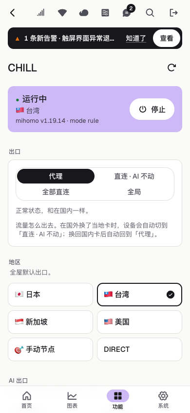

# Getting started: from zero to a fully installed U60 Pro (MU5250)

**English** · [中文](GETTING-STARTED.zh-CN.md)

This guide covers the three repositories together: what each one is, how to build the install kit, how to install it on the device, how to check the result, and how to roll back when something goes wrong.
It is written for people new to this project. Every command comes from scripts already in the repositories; where they differ, the scripts are authoritative.

> **Two things up front**
> 1. This is an unofficial modification, not affiliated with ZTE. Use at your own risk, and only on your own device.
> 2. **No prebuilt binaries are published yet** (the license inventory is not finished), so you build the install kit yourself: one command, covered in section 3.
>    If someone near you already has a built install kit, skip to [section 4](#4-install).

## 1. What each repository does

| Repository | What it is on the device | Purpose |
|---|---|---|
| [luya-z-manager](https://github.com/faying/luya-z-manager) (this repository) | `luyaz-core` (built from `crates/luyaz-core`, `/data/luyaz/luyaz-core`, `127.0.0.1:9460`) + `luyaz-web` (:9090) + `luyaz-sentinel` | The data service and device API, the advanced admin web in the browser, eSIM, CHILL proxy control, **and the install kit (`onboard/`)** |
| [luya-z-touch-ui](https://github.com/faying/luya-z-touch-ui) | `/data/luyaz/ui/` (`luyaz-ui`) | Front-panel touch UI (Rust, `touch-ui/rs/`; its source now lives in this repository under `touch-ui/`), plus the health check and fallback scripts in `/data/luyaz/scripts/` |
| [luya-z-data-service](https://github.com/faying/luya-z-data-service) | (no longer installed) | The original Rust `zwrt-datad`; luyaz-core in this repository replaced it and the kit no longer uses it |

How they connect on the device:

```
ubus / uci / sysfs ──▶ luyaz-core 127.0.0.1:9460 ◀──(/v2/screen, /v2/api)── touch UI luyaz-ui
                             ▲          └──▶ lpac (/data/esim) ──▶ eUICC card
browser ──▶ luyaz-web :9090 ─┘ (one /v2/events stream + /control)
```

luyaz-core is the only service that polls the stock ubus interfaces and the only one that writes settings; luyaz-web and the touch UI read from it and send it their changes.
`luyaz-sentinel` owns the screen (starts the touch UI, hands the screen back to the stock UI) and is the watchdog. zte-agent, which used to serve the API and a Next.js admin on :9090, was removed on 2026-10-14, as were the `u60-uid` and `u60-guard` daemons.

The install kit is built in manager, which builds luyaz-core, luyaz-web and luyaz-sentinel itself and pulls the touch program and scripts from touch-ui.

What it looks like once installed (screenshots use fake data):

| Admin web | Touch UI home |
|---|---|
|  |  |

## 2. Prerequisites

**Device**

- ZTE U60 Pro (MU5250), **firmware B31 or earlier** (in the stock web UI under 「设备信息」 (Device Information), it looks like `…MU5250V1.0.0B31`).
  On B27 or earlier the install kit opens SSH over USB debugging (ADB). From B28 on, ZTE removed the interface for enabling ADB, so you open SSH yourself first (see below); after that the install kit works the same. Versions after B31 have not been tested, so **do not upgrade the firmware before installing.**
  See "Firmware versions" below for what each version means.
- The router admin password (the one you use to log in at `http://192.168.0.1`). The install script uses it to enable ADB through the web interface, then installs key-only SSH (port 2222).
- A USB-C cable that carries data.
- For eSIM, a removable eUICC card (5ber, eSTK.me and the like).

**Firmware versions** (tested: B27; B31 both as an upgrade, since 2026-10-03, and on a device that came with B31, 2026-10-20; B28–B30 not tried but expected to behave like B31)

| Your situation | Result |
|---|---|
| New device, B27 or earlier | Install from scratch with this guide |
| New device, B28 – B31 | **Works**, but ADB cannot be enabled, so the install kit cannot open SSH by itself. Open SSH first through the stock configuration restore (below), then install as usual. Tested on a device that came with B31 |
| Newer than B31 | **Unknown**: not tested |
| Already installed, then upgraded to B31 | The programs themselves run on B31 (the maintainer's device has been on B31 since 10-03). But the upgrade resets `/etc/rc.local` to the stock version and removes the services installed under `/etc/init.d/`, so after the reboot SSH, the admin web, the touch UI and luyaz-core no longer start, and the screen shows the stock UI |

What survives the upgrade: every program and all data under `/data`, the SSH program and keys (`/data/ssh`), the network address, the web password and your settings; firmware auto-update stays off.
To recover, the key step is adding the line that starts SSH back to `rc.local` without ADB. The maintainer did this ***REMOVED***,
***REMOVED***, so the steps are not documented here. Once SSH is back, run `./install.sh admin devui` from a freshly built install kit; it puts the services back and fixes `rc.local`.
Note: `/data/luyaz/kit/rc.local.orig` holds the stock `rc.local` of the firmware **before** the upgrade. To uninstall after an upgrade, do not copy it over the new one; just remove the lines this project added.

**New device on B28 – B31: ***REMOVED***.** When the stock web UI restores a configuration backup, it unpacks the files in it as root with `tar -C /` and then reboots.
So: take a backup in the web UI → ***REMOVED*** to `rc.local`, and put an SSH server (for example the dropbear from the install kit) and your public key into the archive → ***REMOVED*** → restore it in the web UI.
The maintainer did this on a device that came with B31 (2026-10-20): SSH was up about a minute after the restore, and the rest of the install went as on an upgraded device (`./install.sh admin devui` and so on).
This project does not ship a tool or ***REMOVED***; ***REMOVED***, so look there. Keep the untouched backup to restore if something goes wrong, do not insert a SIM or connect any WAN until SSH works (an automatic firmware download could change the format), and make sure you can recover the device the stock way first.

**Install computer** (macOS / Linux / Git Bash on Windows): `adb`, `ssh`, `curl`.

- macOS: `brew install android-platform-tools`
- Linux: `sudo apt install adb`
- Windows: Google SDK Platform-Tools (added to PATH) + Git for Windows

**Build computer** (for compiling; can be the same machine):

| What to build | Needs |
|---|---|
| Everything | **Docker** (Docker Desktop is fine), `git`, `curl`, `python3`, `unzip`, internet access |
| luyaz-core, luyaz-web | Use `cargo-zigbuild` if present, otherwise fall back to Docker automatically |

No cross toolchain needs to be installed: the touch program, the core (luyaz-core), the eSIM tools and the fonts are all built or generated in Docker.
Verified on macOS (Apple silicon or Intel) and x86_64 Linux. The touch program's toolchain is an x86_64 binary, so on Apple silicon it runs under amd64 emulation and is slower.

## 3. Build the install kit

Put the repositories side by side in one directory. **manager and touch-ui are all you need to build a complete install kit; nothing has to be pulled from an already installed device**:

```sh
mkdir u60 && cd u60
git clone https://github.com/faying/luya-z-manager.git
git clone https://github.com/faying/luya-z-touch-ui.git
cd luya-z-manager
./onboard/build-kit.sh
# → onboard/dist/luyaz-kit-YYYYMMDD.tar.gz
```

The first run downloads Docker images and dependencies and takes about 20–30 minutes; after that there are caches (`onboard/cache/`, each repository's `out/`, `rust/target-zig/`) and it is much faster.
`build-kit.sh` does the following in order (where each item comes from and how it is verified):

| Item in the kit | Source |
|---|---|
| dropbear (SSH) | Official OpenWrt 23.05.4 ipk, pinned sha256 |
| luyaz-web (admin web), operator logos | Built from this repository (`crates/luyaz-web`, profile `release`) |
| Touch program | touch-ui's `rs/build.sh device` (Rust, Docker); output `touch-ui/out/luyaz-ui`, installed as `/data/luyaz/ui/luyaz-ui` |
| luyaz-sentinel (screen owner + watchdog) | Built from this repository (`crates/luyaz-sentinel`, profile `release-device`) |
| Touch UI fonts | Nunito (pinned google/fonts commit) and a Chinese fallback font (Resource Han Rounded subset), both OFL, pinned sha256, generated in Docker. The ZTE fonts that ship on the device are not packaged; the touch UI reads them directly from `/usr/ui/fonts/` on the device |
| Core (`luyaz-core`) | luyaz-core from this repository (`cargo zigbuild --profile release-device -p luyaz-core` in `onboard/build.Dockerfile`, image pinned by digest, dependencies locked by `Cargo.lock`) |
| eSIM tools (lpac) | `scripts/esim/build-esim-bundle.sh --out`: lpac and its libraries from Alpine 3.24 (`scripts/esim/alpine.lock` pins versions and sha256) + a statx compatibility shim + `qmi_uim_probe` |
| CHILL (optional) | Official mihomo and zashboard release packages (pinned sha256) + rule sets (latest at download time). Add `CHILL=0` to leave it out |
| Process supervision, health check scripts | touch-ui's `scripts/` |

Before packaging, the script checks: the touch program must be the Rust build (the C/LVGL touch UI was deleted and only survives in the `legacy-c-touch-ui` tag); the core must be the Rust version with no hard-coded external update source. If either check fails, it stops.

You can also build the pieces separately and point `build-kit.sh` at the existing files:

```sh
(cd touch-ui && rs/setup-src.sh && rs/build.sh device out/luyaz-ui)   # read from here by default
CORE_BIN=/path/to/luyaz-core ./onboard/build-kit.sh       # a core built elsewhere instead of building luyaz-core
```

Other variables: `DEVUI_BIN` (touch binary), `SENTINEL_BIN` (luyaz-sentinel), `ESIM_TGZ` (a prebuilt eSIM bundle), `DEVUI_FONTS_DIR` (a prebuilt font directory), `FONTS=0` (no fonts),
`DEVUI_REPO` (default `touch-ui/` in this repository), `SHIP_RECORDS` (the local records `u60 ship` keeps: the touch UI, sentinel and core are then taken from what the device is running, matched by md5, and only built when not found; `FRESH=1` builds anyway). Settings you use often can go in `onboard/kit.local.env` (one `KEY=value` per line, not tracked by git).

> **eSIM bundle fails to build?** When Alpine 3.24 ships a security update, it replaces the pinned packages and the old files disappear from the mirrors. Run
> `python3 scripts/esim/alpine_closure.py --relock` to re-resolve, rebuild, then confirm on one device that `/data/esim/lpac.sh chip info` can read the card before using it.
> Rule sets (CHILL) are not pinned; each build takes the latest version at that time.

## 4. Install

```sh
tar xzf luyaz-kit-*.tar.gz
cd luyaz-kit
./install.sh
```

Follow the prompts:

1. Connect the computer to the U60's **Wi-Fi** and enter the router admin password; the script enables USB debugging through the web interface.
2. When it says it is waiting for the ADB device, connect the U60 to the computer with the USB-C cable.
3. Set an **admin web password** (press Enter to use the same one as the router admin password).
4. Push, install and verify run automatically, in a minute or two. The screen flickers once and switches to the new UI.
5. When asked whether to reboot to verify, answering yes is recommended; the script confirms that SSH, the admin web and the screen all come back on their own after the reboot.

The full set is the four components `ssh admin devui esim`. You can also install only some of them:

```sh
./install.sh ssh               # only enable ADB + install persistent SSH
./install.sh ssh admin devui   # without eSIM
./install.sh chill             # CHILL proxy, not part of the full set, must be named explicitly (see section 7)
```

Installing SSH also **turns off firmware auto-update**. If the U60's address is not `192.168.0.1`, prefix the command with `GATEWAY=your-address`.
Without a terminal (for example when Claude Code installs it for you), passwords are read from the environment variables `ROUTER_PASSWORD`, `AGENT_PASSWORD`, or from `u60.env` in the kit (template `u60.env.example`).

The [README](../onboard/README.md) that ships with the install kit goes into more detail: which paths get installed, day-to-day use, and common problems.

## 5. Check the installation

```sh
./install.sh status     # whether each component is present and running
./install.sh doctor     # read-only health check: boot sync, auto-update, services, heartbeat, Wi-Fi, alerts...
```

Then:

- Open `http://192.168.0.1:9090/` in a browser and log in with the admin web password.
- SSH: `ssh -p 2222 root@192.168.0.1` (key only; after installing, the script prints a snippet you can add to `~/.ssh/config`).
- The admin web's Health page runs the same checks as `doctor`. If the admin web will not open, run `sh /data/luyaz/scripts/doctor.sh` over SSH.

| Login page (phone) | Health page |
|---|---|
|  |  |

## 6. Update, back up, roll back

**Update**: get a new install kit, unpack it and install only the components you want to update (this goes over SSH, no cable needed):

```sh
./install.sh admin      # luyaz-web (admin web)
./install.sh devui      # touch UI + core (luyaz-core)
./install.sh esim       # eSIM tools
./install.sh reboot     # optional: reboot once to confirm everything comes up on boot
./install.sh recover    # optional, not part of the full set: boot-time clean-up used by luyaz-ship.sh
                        #   (adds one line to rc.local; run it only if you use luyaz-ship.sh)
```

If the device has an unfinished `luyaz-ship.sh` transaction (see touch-ui [docs/SHIP.md](https://github.com/faying/luya-z-touch-ui/blob/main/docs/SHIP.md)), `admin`, `devui` and `recover` refuse to install until it is finished or rolled back.

**Back up and restore configuration** (configuration only, no programs; backups contain passwords, do not share them):

```sh
./install.sh backup                   # saved to ./backups/ on this computer (change with BACKUP_DIR)
./install.sh restore backups/xxx.tgz  # lists the files it will change first, writes only after you type yes
```

**Roll back to an older version**: apart from CHILL, the install script does not keep the previous program version. To roll back, install the relevant component again from the older install kit.
If a CHILL update fails, it switches back to the previous version (`.prev`) on its own. If the touch program fails to start twice in a row, `luyaz-sentinel` hands the screen back to the stock UI;
long-press the bottom-right corner of the screen for 3 seconds to switch back.

**Uninstall**: there is no uninstall command; the steps are in the install kit README's 「恢复原厂」 (Restore stock) section: stop and delete the services installed under `/etc/init.d/`,
restore the original `rc.local` from `/data/luyaz/kit/rc.local.orig`, delete the directories installed under `/data`, and reboot (if you upgraded the firmware, see the last note under "Firmware versions" in section 2).

## 7. CHILL proxy (optional)

CHILL is a transparent proxy on the device (native mihomo, TUN mode) plus the zashboard panel. It needs your own subscription URL.

```sh
./install.sh chill                     # first time: install only, do not start
ssh -p 2222 root@192.168.0.1
cp /data/chill/chill.env.example /data/chill/chill.env && chmod 600 /data/chill/chill.env
vi /data/chill/chill.env               # enter the subscription URL
sh /data/chill/chill.sh safe-start     # start; once the whole home network is confirmed working, within 5 minutes:
sh /data/chill/chill.sh confirm        # if not confirmed it stops automatically, so you do not lock yourself out
```

After that, use the admin web's 「CHILL」 page to turn it on or off, change the exit and change the profile.



## 8. Rules every newcomer must follow

- **Do not upgrade the firmware, and do not turn on firmware auto-update.** An upgrade resets `/etc/rc.local` and removes the services installed under `/etc/init.d/`, so SSH and every autostart stop working
  (`/data` and your settings survive), and on versions after B31 nobody knows yet whether a new install works. See "Firmware versions" in section 2.
- **Do not run `/etc/init.d/<stock service> disable`.** The stock master daemon waits for a list of services in its configuration to all be ready before it lets boot continue; if one is missing, the device sticks on the logo, does not dial, and the touchscreen stops responding.
- Autostart goes only through `/etc/rc.local`. Back it up before changing it, and check the syntax with `sh -n /etc/rc.local` afterwards.
- Programs and data go in `/data`. `/tmp` is a RAM disk and is cleared on reboot. Do not write partitions, do not `dd`.
- **There must always be a UI on the screen.** If no UI is shown for a few minutes, the firmware reboots the whole device. Any step that stops one UI must start another in the same step.
- **Test a newly built touch program under a different file name first.** If you overwrite the live location `/data/luyaz/ui/luyaz-ui` directly and it crashes on start,
  the firmware escalates that into a whole-device reboot loop. Always keep a working backup next to the live location. Regular users should just update with `./install.sh devui`.
- If you are connected remotely through this U60's own network, do not switch to an eSIM profile without data, and do not change the APN, network mode or Wi-Fi carelessly: once switched, you cannot get back in.

## 9. FAQ

- **Keeps waiting for the ADB device**: try another cable or another USB port (not a hub). The connection works only when `adb devices` shows a line with `device`. Windows may need the Google USB Driver.
- **SSH will not connect**: the computer is not on the U60's Wi-Fi, or a proxy app's TUN/enhanced mode is hijacking `192.168.0.1`. Set `192.168.0.0/16` to direct in the proxy,
  and add `--noproxy '*'` when testing with `curl`.
- **Admin web will not open but SSH works**: most likely the proxy as well. Verify on the device: `wget -q -O- http://127.0.0.1:9090/ | head -c 200`.
- **SSH occasionally refuses connections**: dropbear refuses reconnects that come too quickly; wait a few seconds and try again. Combine multiple commands into one `ssh` where possible.
- **No data on the screen**: `/etc/init.d/luyaz-core restart`, then check `/tmp/luyaz-core.log`.
- **Web login locked**: the stock web UI locks for a while after 5 wrong passwords in a row. The script shows the remaining attempts and a countdown; do not keep retrying.
- **`admin` / `devui` refuse to install, saying there is an unfinished transaction**: a `luyaz-ship.sh` update did not finish. Finish it or roll it back first (touch-ui `docs/SHIP.md`); do not delete the transaction log by hand.
- **Install failed halfway**: `install.sh` can be rerun; parts already installed are skipped or overwritten.
- **Device time looks off by several hours**: the firmware stores local time as UTC, and both the admin web and the touch UI display local time. This is expected.
