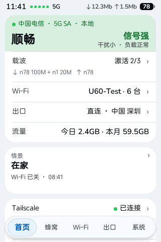
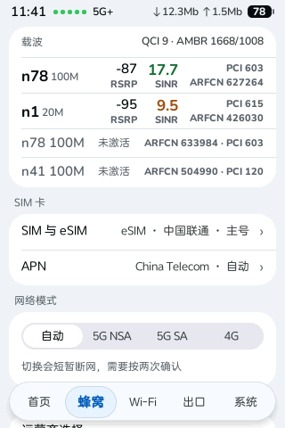
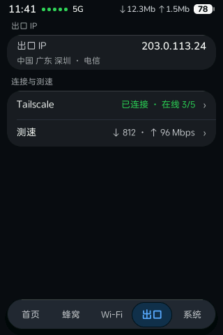
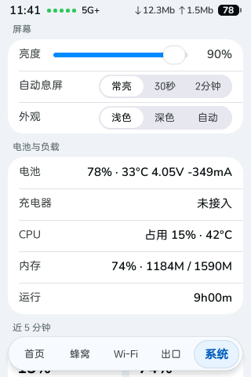

# Luya-Z 触屏界面

[English](README.md) · **中文**

**Luya-Z** 的一部分：5G 随身 Wi-Fi 前面板 3.5 寸触屏的开源替代界面。用 Rust + LVGL + FreeType 写成，直接画到 DRM/KMS，经 evdev 读触摸，编成一个静态 aarch64 程序（设备上叫 `luyaz-ui`），独立于原厂界面运行。

> **适用硬件：** 中兴 U60 Pro（MU5250）。社区项目，和中兴（ZTE）没有关系，风险自负。

| 首页 | 蜂窝 | 出口（深色） | 系统 |
|---|---|---|---|
|  |  |  |  |

（截图由离屏渲染测试用假数据生成。）

屏幕文字默认中文，可在系统设置里切换英文。

## 在哪里

触屏界面是 [luya-z-manager](https://github.com/faying/luya-z-manager) 仓库的 `touch-ui/` 目录，它的 Rust crate 是 manager Cargo workspace 的成员。原来单独的 `luya-z-touch-ui` 仓库已被取代，不再更新。

| 组件 | 源码 | 设备上的角色 |
|---|---|---|
| **luyaz-ui**（本目录） | `touch-ui/rs/` | 前面板触屏界面 |
| luyaz-core | `crates/luyaz-core` | 本机后端 `127.0.0.1:9460`：`/v2/state`、SSE `/v2/events`、`/v2/screen`，写操作走 `/v2/api/...` |
| luyaz-web | `crates/luyaz-web` | 管理网页 `:9090` |
| luyaz-sentinel | `crates/luyaz-sentinel` | 屏幕主人兼看门狗（控制 FIFO `/tmp/luyaz-screen.ctl`） |

```
luyaz-core :9460 ──▶ luyaz-ui（触屏，DRM/KMS）
       ▲   └──▶ lpac ──▶ eUICC 卡
浏览器 ──▶ luyaz-web :9090 ──▶ luyaz-core
luyaz-sentinel：屏幕主人 + 看门狗
```

界面只通过这个本机 HTTP 接口和 luyaz-core 打交道，自己从不碰 ubus。luyaz-core 读系统状态、提供 JSON，eSIM、APN 等操作也由它执行。

## 功能

- 底部 5 个标签，按「我想做什么」分：**首页 · 蜂窝 · Wi-Fi · 出口 · 系统**。首页大字是一句结论（网络正常 / 信号偏弱 等）。
- 蜂窝：载波、信号、网络模式、APN、SIM 与 eSIM 切换（经 luyaz-core 调 lpac）。
- 出口：出口 IP 与归属地；Tailscale；装了 CHILL 时还有代理出口、分组、节点和流量（[docs/CHILL.md](docs/CHILL.md)、[docs/PROXY.zh-CN.md](../docs/PROXY.zh-CN.md)）。
- 系统：亮度、息屏、浅色 / 深色 / 自动，语言，电池与负载、告警详情。
- USB-C 口插上手机：和原厂屏幕一样问用来做什么——充电 + 上网（手机得到 USB 网卡）、18W 快速充电宝、网口配件——可以记住选择（系统 › 插入手机等设备时）。
- 每次点击都有即时反馈；要确认的操作按两次。
- **luyaz-sentinel** 是屏幕唯一的主人：拉起或接管界面，崩了自动拉起并记告警；连续两次没稳住就交还原厂界面（避免被固件升级成整机重启），长按屏幕右下角回来。

## 快速开始

装到设备上请看 manager 仓库的 **[快速上手](../docs/GETTING-STARTED.zh-CN.md)**：装机包（`onboard/`）会编出这个界面，和 luyaz-core、luyaz-web、luyaz-sentinel 一起装到设备上。已装好的设备单独更新某个组件，见 [docs/SHIP.md](docs/SHIP.md)（旁路试跑、原子替换、可回滚）。

## 构建

用 Docker：

```sh
rs/setup-src.sh              # 一次：把打过补丁的 LVGL + FreeType 源码放进 Docker 卷
rs/build.sh device [FILE]    # → target/aarch64-unknown-linux-musl/release-device/luyaz-ui
rs/build.sh test             # cargo test
```

在共用构建镜像（`onboard/build.Dockerfile`）里用 cargo zigbuild 编，LVGL 固定 v9.5。装机包 `onboard/build-kit.sh` 自己会调 `rs/build.sh device`。
触屏字体（Nunito、中文兜底）用 `scripts/fonts/build-nunito.sh`、`scripts/fonts/build-cjk-fallback.sh` 生成（公开下载按 sha256 固定），装机包会自动调。

代码结构：入口 `rs/devui/src/main.rs`，各页 `rs/devui/src/ui/`，组件 `kit.rs`，色板 `theme.rs`，显示和触摸在 `rs/plat`。离屏渲染测试在 `rs/devui/src/render/`（`rs/smoke.sh`、`rs/parity.sh`）；`scripts/test/docker.sh` 在 busybox 容器里跑设备端脚本测试。设计规则见 [docs/DESIGN.zh-CN.md](../docs/DESIGN.zh-CN.md) §4。更多见 [docs/DEVELOPMENT.zh-CN.md](docs/DEVELOPMENT.zh-CN.md)。

之前的 C 版已删除，留在 git tag `legacy-c-touch-ui`；更早的 litehtml 渲染器在 tag `legacy-litehtml`。

## 在设备上

> **新构建不要直接覆盖设备上的正式程序。** 一启动就崩的版本会被固件升级成整机重启循环；屏幕上几分钟没有界面，固件也会整机重启。
> 先用别的文件名试跑，步骤见 [docs/DEVELOPMENT.zh-CN.md](docs/DEVELOPMENT.zh-CN.md#在真机上试新版本) 和 [docs/SHIP.md](docs/SHIP.md)。

布局：界面是 `/data/luyaz/ui/luyaz-ui`（进程名 `luyaz-ui`），设置 `devui.conf`、`operator-logos/` 目录和字体也在 `/data/luyaz/ui/`。界面由 luyaz-sentinel（`/etc/init.d/luyaz-sentinel`）拉起，自己不起。

## 可靠性脚本

`scripts/` 里是配合 manager 仓库使用的设备端脚本（约定见 [docs/RELIABILITY.zh-CN.md](../docs/RELIABILITY.zh-CN.md)）：procd 启动脚本（`luyaz-core.init`、`luyaz-web.init`、`luyaz-sentinel.init`）、更新执行器和开机恢复（`u60-ship.sh`、`u60-recover.sh`）、只读体检（`doctor.sh`）、配置备份（`config-backup.sh`）等。

## 文档

- [docs/DEVELOPMENT.zh-CN.md](docs/DEVELOPMENT.zh-CN.md)：代码结构、构建、测试、真机试跑
- [docs/HARDWARE.zh-CN.md](docs/HARDWARE.zh-CN.md)：屏幕、触摸、按键、背光等硬件接口
- [docs/ESIM.zh-CN.md](docs/ESIM.zh-CN.md)：eSIM 切换页
- [docs/SPEEDTEST.zh-CN.md](docs/SPEEDTEST.zh-CN.md)：测速页
- [docs/SHIP.md](docs/SHIP.md)：组件更新的设备端格式
- 设计规范：[docs/DESIGN.zh-CN.md](../docs/DESIGN.zh-CN.md) §4

## 致谢

- Wei REN：Rust + LVGL 触屏界面（luyaz-ui）、eSIM 页、Tailscale 卡片。
- [33333s](https://github.com/33333s)：[u60pro-devui](https://github.com/33333s/u60pro-devui) 是本触屏界面的起点（其 C 代码现已全部换掉）；界面读取的 luyaz-core，其设备读写层来自 [zwrt-datad](https://github.com/33333s/zwrt-datad)。
- [Jesther Silvestre](https://github.com/jesther-ai)：[open-u60-pro](https://github.com/jesther-ai/open-u60-pro)，manager 仓库的起点。

## 许可证与免责声明

[MIT](LICENSE)。LVGL（MIT）、FreeType（FTL / GPLv2）、stb（public domain）按各自许可证使用，详见 [NOTICE](NOTICE)。
仓库不含任何中兴字体或厂商二进制。和中兴通讯没有关系，只在你自己的设备上使用。
